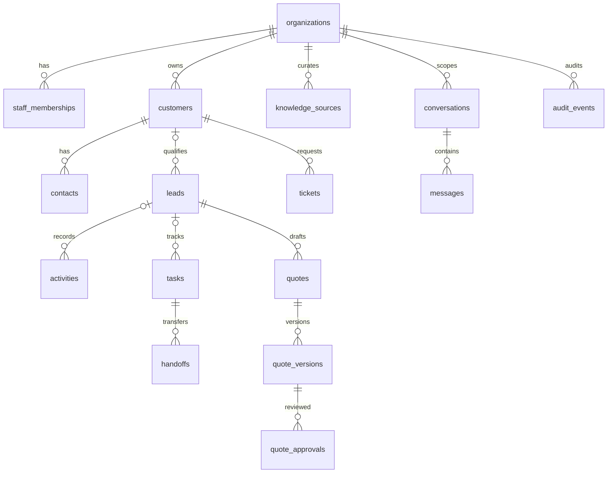

# DKL-ERD-001 — ERD and Data Dictionary

Version: 0.1 | Owner: Lead Engineer / Database Architect | Status: Proposed, implementation gated by review

## Evidence and boundary

The baseline is `bstBizEra/dklWeb2026` revision `29057c6435f65c3f8448532c094f9604542b43d8`. Observed lead capture uses `POST /api/leads/quote`, Zod validation and JSONL persistence at `data/leads-local.jsonl`. No Supabase database, application authentication or operational CRM was verified. Everything below is a target design, not a deployed schema. Existing public website behavior must remain compatible during migration.

The first release serves DK LAO staff. `organization_id` provides an explicit data boundary even for one organization. Customer portal access is a later gate: a customer record alone never grants login access. Store Lao and English as Unicode text; preserve model numbers, SKUs and document reference IDs unchanged.

## Relationships

Each relationship above is one-to-many, except quote to version is one-to-many with exactly one designated current version. Contact is optional for a lead; lead is optional for a ticket and conversation. Customer may initially be absent for an unqualified inbound lead. SQL migrations, when authored, must contain the exact foreign keys below; this diagram is a scoped relationship overview.

## Shared conventions

All business tables have `id uuid PRIMARY KEY DEFAULT gen_random_uuid()`, `organization_id uuid NOT NULL`, `created_at timestamptz NOT NULL DEFAULT now()`, `updated_at timestamptz NOT NULL DEFAULT now()`, and `version integer NOT NULL DEFAULT 1 CHECK (version > 0)`, unless overridden. Organization FK references `organizations(id) ON DELETE RESTRICT`. Mutable records use a server update trigger for time and version. Audit events, messages, quote versions and quote approvals are append-only. Quote approval is a separate event; it never edits the financial snapshot. All child FKs use `ON DELETE RESTRICT`; archival replaces destructive deletion during ordinary operations.

For every organization-scoped target referenced by another scoped table, define `UNIQUE (organization_id,id)` and a composite FK `(organization_id,target_id)` to prevent cross-organization linking. Nullable composite references use normal MATCH SIMPLE behavior. References to Auth users use `auth.users(id)`; authorization still requires active membership. Monetary values use `numeric(18,2)`, never floating point. `char(3)` currency must match uppercase ISO-style three-letter codes; approved allowed currencies are configured separately. UUIDs are generated by the server, not the model.

## Dictionary

| Table | Fields beyond shared conventions | Constraints and purpose |
|---|---|---|
| `organizations` | `name text NOT NULL`, `slug text NOT NULL`, `default_language text NOT NULL DEFAULT 'lo'`, `archived_at timestamptz NULL` | Omits its own `organization_id`; `UNIQUE(slug)`; language `IN ('lo','en')` |
| `staff_memberships` | `user_id uuid NOT NULL`, `role text NOT NULL`, `active boolean NOT NULL DEFAULT true` | Auth FK; `UNIQUE(organization_id,user_id)`; role `IN ('admin','sales','operations','support')`; role changes audited |
| `customers` | `display_name text NOT NULL`, `kind text NOT NULL`, `preferred_language text NOT NULL DEFAULT 'lo'`, `external_ref text NULL`, `archived_at timestamptz NULL` | Kind `IN ('individual','business')`; language `IN ('lo','en')`; partial unique external reference within organization when non-null |
| `contacts` | `customer_id uuid NOT NULL`, `name text NOT NULL`, `email text NULL`, `phone text NULL`, `position text NULL`, `preferred_language text NOT NULL DEFAULT 'lo'`, `archived_at timestamptz NULL` | Composite customer FK; at least one email/phone required; language check; phone retained as text; duplicates reviewed rather than phone globally unique |
| `leads` | `customer_id uuid NULL`, `contact_id uuid NULL`, `assigned_to uuid NULL`, `reference text NOT NULL`, `source text NOT NULL`, `business_line text NOT NULL`, `request_text text NOT NULL`, `status text NOT NULL DEFAULT 'NEW'`, `language text NOT NULL DEFAULT 'lo'`, `public_submission_key text NULL`, `received_at timestamptz NOT NULL DEFAULT now()`, `closed_at timestamptz NULL` | Composite customer/contact/staff membership FKs; unique reference per organization; partial unique submission key; statuses below; server controls status/received time; if both customer/contact set, contact must belong to that customer using a composite contact/customer constraint |
| `activities` | `lead_id uuid NULL`, `customer_id uuid NULL`, `actor_membership_id uuid NOT NULL`, `kind text NOT NULL`, `summary text NOT NULL`, `occurred_at timestamptz NOT NULL DEFAULT now()` | Composite FKs; at least one lead/customer; kind `IN ('note','call','email','meeting','handoff','status_change')`; append-only; inherited version remains 1 |
| `tasks` | `lead_id uuid NULL`, `ticket_id uuid NULL`, `assignee_membership_id uuid NOT NULL`, `title text NOT NULL`, `status text NOT NULL DEFAULT 'OPEN'`, `due_at timestamptz NOT NULL`, `completed_at timestamptz NULL`, `handoff_from uuid NULL` | Composite FKs including staff; status `IN ('OPEN','IN_PROGRESS','BLOCKED','DONE','CANCELLED')`; DONE requires completion time; completed timestamp absent for open states |
| `tickets` | `customer_id uuid NOT NULL`, `lead_id uuid NULL`, `assigned_to uuid NULL`, `reference text NOT NULL`, `subject text NOT NULL`, `description text NOT NULL`, `category text NOT NULL`, `priority text NOT NULL DEFAULT 'NORMAL'`, `status text NOT NULL DEFAULT 'OPEN'`, `resolved_at timestamptz NULL` | Composite FKs; unique reference per organization; priority `IN ('LOW','NORMAL','HIGH','URGENT')`; status `IN ('OPEN','ASSIGNED','IN_PROGRESS','WAITING_CUSTOMER','RESOLVED','CLOSED')`; resolution timestamp required for RESOLVED/CLOSED |
| `quotes` | `lead_id uuid NOT NULL`, `reference text NOT NULL`, `current_version_id uuid NULL`, `status text NOT NULL DEFAULT 'DRAFT'` | Composite lead FK; unique reference per organization; status `IN ('DRAFT','PENDING_APPROVAL','APPROVED','SENT','EXPIRED','REJECTED')`; current version FK scoped to organization AND quote; insert quote then version then set current version in one transaction |
| `quote_versions` | `quote_id uuid NOT NULL`, `revision integer NOT NULL`, `currency char(3) NOT NULL`, `line_items jsonb NOT NULL`, `total numeric(18,2) NOT NULL`, `terms text NOT NULL`, `valid_until date NULL`, `prepared_by uuid NOT NULL`, `content_hash text NOT NULL` | Composite quote/staff FKs; `UNIQUE(organization_id,quote_id,revision)`; revision > 0 and total >= 0; JSON must be array; Zod validates item SKU/name/quantity/unit price/tax and server recomputes total; immutable financial snapshot; approval lives in quote_approvals |
| `quote_approvals` | `quote_version_id uuid NOT NULL`, `approver_membership_id uuid NOT NULL`, `decision text NOT NULL`, `content_hash text NOT NULL`, `note text NULL`, `decided_at timestamptz NOT NULL DEFAULT now()` | Composite version/staff FKs; decision APPROVED/REJECTED; append-only; submitted hash must equal version hash; partial unique approved decision per version; approver capability checked server-side |
| `handoffs` | `task_id uuid NOT NULL`, `from_membership_id uuid NOT NULL`, `to_membership_id uuid NOT NULL`, `status text NOT NULL DEFAULT 'PENDING'`, `purpose text NOT NULL`, `checklist jsonb NOT NULL`, `due_at timestamptz NOT NULL`, `responded_at timestamptz NULL`, `response_reason text NULL` | Composite task/staff FKs; states PENDING/ACCEPTED/RETURNED/CANCELLED; response time required for terminal response; RETURNED requires reason; task ownership changes only on acceptance; audit records transitions |
| `knowledge_sources` | `title text NOT NULL`, `owner_membership_id uuid NOT NULL`, `access_scope text NOT NULL DEFAULT 'STAFF'`, `language text NOT NULL`, `business_line text NULL`, `source_uri text NOT NULL`, `source_revision text NOT NULL`, `content_hash text NOT NULL`, `content_text text NOT NULL`, `verification_status text NOT NULL DEFAULT 'DRAFT'`, `verified_by uuid NULL`, `verified_at timestamptz NULL`, `review_due_at timestamptz NULL` | Composite staff FK; language `IN ('lo','en','mixed')`; status `IN ('DRAFT','VERIFIED','RETIRED')`; VERIFIED requires verifier and time; unique URI/revision per organization; access scope STAFF/PUBLIC; owner required; only current verified sources within approved review window and allowed actor scope eligible for agent retrieval |
| `conversations` | `customer_id uuid NULL`, `lead_id uuid NULL`, `owner_membership_id uuid NOT NULL`, `language text NOT NULL DEFAULT 'lo'`, `status text NOT NULL DEFAULT 'OPEN'` | Composite FKs; language `IN ('lo','en')`; status `IN ('OPEN','ARCHIVED')`; staff-only initially |
| `messages` | `conversation_id uuid NOT NULL`, `role text NOT NULL`, `content text NOT NULL`, `source_refs jsonb NOT NULL DEFAULT '[]'`, `tool_summary jsonb NULL` | Composite conversation FK; role `IN ('user','assistant','system','tool')`; source refs array; append-only; never store credentials or full raw provider traces |
| `audit_events` | `actor_user_id uuid NULL`, `actor_type text NOT NULL`, `action text NOT NULL`, `entity_type text NOT NULL`, `entity_id uuid NULL`, `request_id uuid NOT NULL`, `metadata jsonb NOT NULL DEFAULT '{}'`, `occurred_at timestamptz NOT NULL DEFAULT now()` | Auth FK for human actor; actor type `IN ('staff','public','system')`; append-only; metadata allowlist excludes message bodies and secrets; entity ID intentionally polymorphic, with service validation rather than fictitious FK |
| `idempotency_records` | `actor_scope text NOT NULL`, `key text NOT NULL`, `request_hash text NOT NULL`, `response_status integer NULL`, `response_body jsonb NULL`, `expires_at timestamptz NOT NULL` | Unique `(organization_id,actor_scope,key)`; actor scope derived by server; bounded TTL; atomic claim prevents duplicate mutations; response payload excludes secrets |

Lead status check: `NEW`, `CONTACTED`, `QUALIFYING`, `QUOTATION_PREPARING`, `QUOTATION_SENT`, `FOLLOW_UP`, `WON`, `LOST`, `CLOSED`. Status transitions are enforced by a reviewed server state machine, not merely enum membership. Final states require a recorded reason/activity. Admin correction records evidence and cannot silently bypass auditing.

## Access and indexes

RLS is enabled and forced where applicable on every organization-scoped table. A server-validated Auth session and active membership establish organization and role. Administrative API keys never reach browser code. Browser CRUD is denied initially; server services execute as the authenticated user wherever feasible. Public ingestion uses a narrow server capability, rate limiting and validated organization configuration; it cannot list leads. Staff broad customer visibility is an explicit P0 decision; task assignment and departmental write rights are separate from read rights. Portal policies and membership tables must be reviewed before customer access is enabled.

Minimum indexes: `staff_memberships(user_id,organization_id) WHERE active`; `leads(organization_id,status,updated_at DESC)`; `leads(organization_id,assigned_to,status)`; `contacts(organization_id,customer_id)`; `tasks(organization_id,assignee_membership_id,status,due_at)`; `tickets(organization_id,status,priority,updated_at DESC)`; `activities(organization_id,lead_id,occurred_at DESC)`; `messages(organization_id,conversation_id,created_at,id)`; `audit_events(organization_id,entity_type,entity_id,occurred_at DESC)`; `knowledge_sources(organization_id,verification_status,business_line)`. Add only workload-proven search/vector indexes; no vector store is assumed in P0.

## Lifecycle and migration

Retention values are proposed operational defaults, subject to the security review and applicable local requirements: rejected public spam 30 days; expired idempotency records 24 hours; ordinary conversations 180 days; CRM interactions 24 months after account closure; audit and commercial records owner-approved retention before production. Legal hold overrides purge. Backups use the same confidentiality controls and documented expiry. Deletion jobs must preserve referential integrity and produce a non-sensitive audit event.

Migration sequence: inventory JSONL fields; snapshot and hash source file; create staging schema in isolated environment; import with original timestamp marked as legacy provenance; generate deterministic import keys; reconcile line count/accepted/rejected/duplicate counts; verify Lao text and lead status; dry-run rollback; enable database writes behind flag; drain/reconcile bridge; switch read path. Never expose the JSONL file via public hosting. Malformed rows go to restricted quarantine without being silently discarded. Rollback disables new writes, exports post-cutover delta, restores prior code and reconciles delta before reopening ingestion; reverting code alone is insufficient. No SQL has been executed for this proposal.

## Acceptance links

R01: membership/RLS; R02: language fields/Unicode; R03: verified source revisions; R04–R05: leads and status; R06: tasks/activities; R07: tickets; R08: immutable quote versions; R09: identity-bound conversation/tool operations; R10: audit and indexed reporting. QA must prove cross-organization access denial, relationship integrity, duplicate suppression, concurrent update rejection, immutable approval snapshots and import reconciliation.
