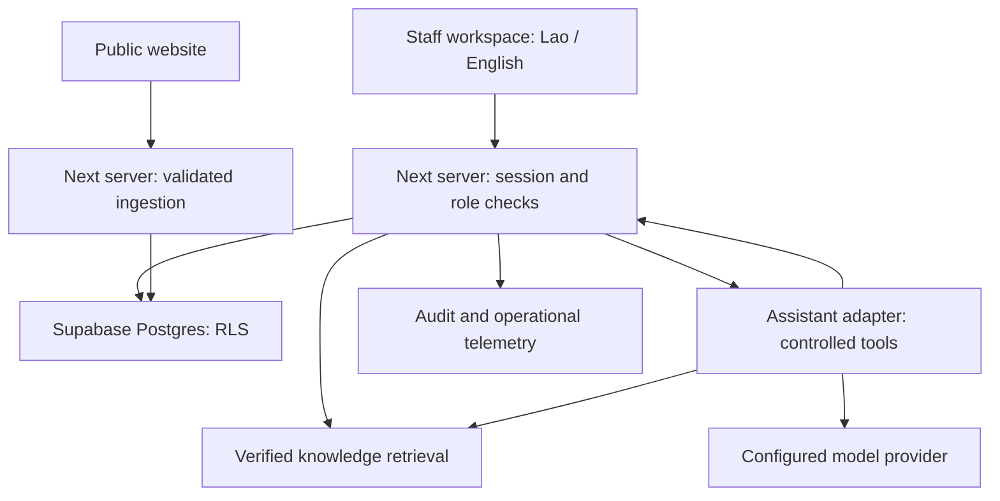

# DKL-SDD-001 — Technical Architecture and System Design

Version: 0.1 | Owner: Technical Lead / System Architect | Status: Proposed design; baseline reuse required

## Baseline and implementation boundary

Reuse `bstBizEra/dklWeb2026` at `29057c6435f65c3f8448532c094f9604542b43d8`, targeting the owner's Windows checkout `C:\laragon\www\dklAgent`. The observed stack is Next.js 16.2.9, React 19.2.7, TypeScript 6.0.3, pnpm, Vitest 4.1.9 and Zod 4.4.3. Existing public lead capture is `src/app/api/leads/quote/route.ts`, validated by `src/lib/validation/leads.ts`, with `storeLocalLead` writing `data/leads-local.jsonl`. Authentication, Supabase CRM persistence and an AI runtime are not verified as implemented. Supabase project and Vercel target selection remain unresolved. A shell clone requires accessible repository credentials; no Windows filesystem access is implied by a cloud workspace.

Preserve the current public website and route contract. Add staff capabilities as bounded modules within the same Next application. Do not change framework, package manager or dependency major versions to implement CRM. Exact package additions require lockfile review and clean install verification. Proposed modules: identity, CRM, workflow, support, quotations, verified knowledge, assistant and audit.

## Target topology

The adapter does not possess independent authorization. Tools invoke application services using verified actor context; the model cannot choose organization, role or user identity. Assistant content and retrieved documents are untrusted data. Observability stores correlation IDs and bounded metrics; customer text is excluded from default logs.

## Execution model and authorization

A request validates its session, resolves active staff membership, validates input using Zod, evaluates role and resource rules, performs transactional mutation, writes audit evidence, and returns a bounded response. Unauthorized requests never retrieve customer records or construct provider prompts. RLS provides a second independent data boundary. A service role is allowed only for narrowly scoped ingestion, migration or operations, with organization scope set by trusted server configuration. Secret keys remain server-only.

Roles proposed for review: admin manages membership/configuration and approves quotes; sales manages leads and quote drafts; operations manages delivery/maintenance handoff tasks; support manages tickets and customer follow-ups. Membership administration and quote approval are separate capabilities even if initially assigned to admin. No role may suppress audit evidence. Staff receive appropriate read access to customer context, with sensitive notes separately classified if required.

Public intake is append-only. Staff-only APIs require login. Customer portal and external customer chat are later scope and require verified account-to-customer memberships; email equality alone never establishes ownership.

## API conventions

Staff APIs use `/api/internal/v1`. JSON errors preserve the repository envelope `{ok:false,error:{code,message,details},requestId}`, with field details only for validation and no secrets. Success preserves `{ok:true,data,message,requestId}`. Use 400 malformed JSON, 401 no session, 403 denied capability, 404 unavailable scoped resource, 409 invalid transition/idempotency conflict, 412 stale version, 422 schema validation, 429 rate limit, and 503 unavailable dependency. Return `Retry-After` for 429 where feasible. Unknown exceptions produce generic 500 and server correlation evidence.

Mutation endpoints require `Idempotency-Key` for create/action operations and `If-Match: "<integer-version>"` for updates. Matching duplicate requests return the stored result; same key/different canonical payload returns 409. Organization and actor scope are derived server-side. Version comparison, mutation and audit insert are atomic; a stale update returns 412 with current version only if the actor retains access. GET collections accept `limit` (default 25, max 100) and opaque cursor; stable ordering uses timestamp plus UUID. Dates are UTC ISO 8601; UI renders Asia/Vientiane. Avoid customer data in URL query parameters.

| Endpoint | Request / result | Capability and side effect |
|---|---|---|
| `GET /session` | Active membership, language, capabilities | Session required; no mutation |
| `GET /leads` | Status/assignee filters; paginated summaries | Staff scoped read |
| `POST /leads` | Business line, request, language, optional customer/contact; returns lead/reference/version | Sales create; server assigns NEW and timestamps |
| `PATCH /leads/{id}` | Allowlisted descriptive fields and assignment | Sales/admin; If-Match; no generic status overwrite |
| `POST /leads/{id}/transitions` | Target status, reason, optional next task | Sales/admin; verifies transition requirements; activity and audit atomically |
| `POST /customers` | Name, kind, preferred language, optional contacts | Sales/support; no automatic account creation |
| `POST /tasks` | Lead or ticket, assignee, title, due time | Department capability; validates recipient active membership |
| `POST /tasks/{id}/handoff` | Recipient, reason, next action, due time | Task owner/admin; old/new ownership and audit atomic |
| `POST /tickets` | Customer, category, subject, description, priority | Support; reference and status server-generated |
| `POST /tickets/{id}/transitions` | Target, reason, resolution summary when closing | Support; stale version guarded |
| `POST /quotes` | Lead, proposed item lines, currency, terms | Sales; server calculates draft total; no customer dispatch |
| `POST /quotes/{id}/approve` | Revision/hash, approval note | Authorized approver; immutable approved version; If-Match |
| `GET /knowledge/search` | Query and language; verified source excerpts/references | Staff; source freshness and scope applied |
| `POST /assistant/messages` | Conversation ID or new context, text, preferred language | Staff; records bounded messages; adapter may draft/lookup only by default |
| `POST /assistant/actions/{id}/confirm` | Reviewed action payload/hash | Actor with action capability; revalidate freshness; no authority from prior model text |
| `GET /reports/pipeline` | Aggregated status counts, overdue tasks, qualified conversion | Authorized staff; filters and denominators explicit |

R08 quotation approval does not automatically send, reserve inventory or accept a contract. Dispatch requires a separately reviewed integration and explicit authorization. No email, messaging, payment or ERP connector is presumed available.

## Public ingestion bridge

Retain `POST /api/leads/quote` and its established response shape/status until baseline contract tests capture them; the observed envelope is `{ok:true,data:{leadId,status},message}` on success and `{ok:false,error:{code,message,details}}` on failure. Keep existing required fields accepted. Stop trusting submitted `status`, actor IDs and timestamps: strip or ignore these through server mapping while preserving valid submissions. Add server-generated reference and received time internally. Document any newly exposed response fields as additive changes only.

Deploy a `LeadRepository` interface with existing JSONL and proposed database adapters. Start with a disabled database flag and integration tests; then use a bridge/outbox strategy with a stable submission ID and reconciliation. Avoid naive dual writes: failure between two sinks creates divergent truth. Public requests return success only after durable acceptance by the selected authoritative sink. A worker may forward legacy accepted records idempotently. On Vercel, ephemeral function filesystem storage is unsuitable as authoritative CRM persistence; block production activation until database persistence is verified. The JSONL adapter remains local development compatibility only.

## Lao–English UX and knowledge

UI dictionaries use stable translation keys with Lao/English labels. Store a user's explicit language preference. Mixed-language input is accepted; assistant follows the selected language and keeps technical identifiers exact. Lao shaping fonts and responsive rendering are verified by UX/QA. Prefer approved bilingual terminology rather than literal ad-hoc translation of product commitments.

Seed knowledge from supplied 2024 catalogue and June 2026 website summary with provenance, dates and review state. Treat the six supported business lines as source-grounded candidates; 2024-only lines remain unconfirmed until staff verification. Source documents are content, never runtime instructions. Do not invent price, stock, availability, warranty, SLA or customer history. Answers cite source title/revision and direct uncertain requests to an accountable staff task.

## Assistant runtime

Implement a provider-neutral server adapter after dependency and provider review. Interface accepts verified actor context, conversation, user language and allowed tools; returns answer, cited source references and proposed actions. P0 deterministic mode can search verified knowledge and provide workflow guidance without a model. Model calls require configured credentials, timeout, per-user limits, token budget and redacted logs. Provider failure offers a useful manual workflow and never marks a mutation complete.

Tools are narrowly typed: `searchVerifiedKnowledge`, `getScopedLead`, `listMyTasks`, `draftQuotation`, `proposeFollowUp`, `proposeTicket`. Draft tools produce reviewable proposals. Confirmed writes re-run permissions and record server execution evidence; the model's statement that something was saved is not proof. Block arbitrary SQL, shell, URLs, file access and outbound messages. Use an allowlisted ingestion fetcher for knowledge imports with SSRF controls; imports remain DRAFT until verified.

## Deployment, scale and resilience

Separate local, staging and production configurations and databases. Use migrations tracked in git, restricted secrets, backup verification and a rehearsed restore before production. Preview deployments must use synthetic data. No connector project discovered means no project has been provisioned or linked by this document. Select existing Vercel/Supabase projects or explicitly authorize provisioning as a subsequent concrete deployment task.

Begin as a modular monolith. Indexed cursor queries and bounded pagination serve CRM workloads; background jobs handle imports and scheduled follow-ups only when a verified scheduler exists. At scale use a durable job/outbox table with leases, retries, dead-letter handling and idempotent consumers. Never depend on one serverless process to hold task state. Establish connection pooling and database limits from the chosen plan; no unverified capacity promises.

Proposed SLOs to validate in staging: 95th percentile ordinary CRM read < 1 second at 20 concurrent staff and 10,000 leads; ingestion < 2 seconds excluding external AI; provider timeout <= 30 seconds; zero acknowledged submissions lost; recovery point <= 24 hours and recovery time <= 4 hours pending backup plan capability. Report these as targets, not achieved results.

## Delivery gates and rollback

1. Clone/reuse baseline; inspect AGENTS.md, lockfile, tests and public route contracts. Record evidence and actual clone path.
2. Freeze PRD/UX/ERD/security decisions; define written work items and acceptance cases.
3. Add identity and prove role/organization denial before CRM exposure (R01).
4. Add database adapters and ingestion reconciliation (R04); validate actual field mappings against source route.
5. Deliver pipeline, tasks, tickets and draft quotations incrementally (R05–R08).
6. Enable verified knowledge and Lao/English guidance (R02–R03); controlled AI last (R09).
7. Run security, negative authorization, regression, import and restore checks; attach evidence (R10). No merge or production release solely on agent self-report.

Use feature flags for additive modules. Back up before migrations; prefer expand-and-contract schema changes. Rollback an app deployment only after ensuring previous code accepts current schema. For ingestion cutover, halt writes briefly if required, preserve post-cutover deltas and reconcile before reopening; never discard new customer submissions. Destructive migration requires a separate reviewed plan. Actual test results, migrations and deployment URLs remain pending implementation.

## Traceability

PRD R01–R10 map directly to the module/API/schema definitions above and ERD document. QA cases must cover permissions, bilingual rendering, source verification, durable capture, allowed state transitions, accountable handoffs, ticket resolution evidence, immutable quote approval, prompt injection and audit completeness. Work packages record baseline SHA, changed paths, commands, outcomes, unresolved risks and next owner action.
