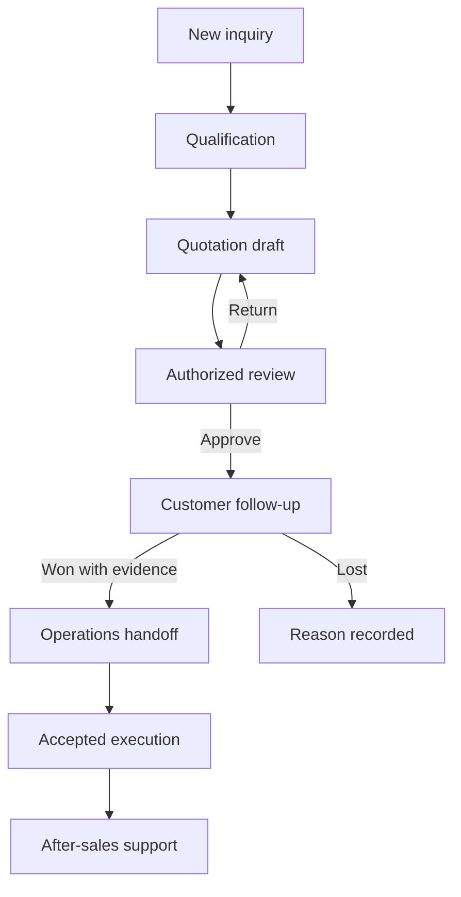

# DKL-UX-001 — DK LAO Business Assistant UX Specification

Version: 0.1 • Status: proposed design baseline • Owner: UX/UI Designer • Date: 2026-10-08

## 1. Design foundation and evidence

Extend the canonical public website; introduce a separate authenticated staff workspace. Preserve verified public routes and intake behavior. Routes in this document are proposed, except existing `/`, `/about` and `/api/leads/quote`. The supplied June 2026 summary describes pages not verified at canonical commit `29057c6435f65c3f8448532c094f9604542b43d8`; reconciliation precedes adding links.

Reuse documented brand tokens: navy `#07111F`, blue `#0061AF`, deep blue `#154A99`, action red `#D91A21`. Test color contrast before adopting each foreground/background pair; a brand token is not a contrast certification. Red marks primary conversion actions or destructive risk with explicit text, never status alone.

## 2. Information architecture

| Proposed route | Purpose | Access |
|---|---|---|
| `/staff` | Role-relevant overview: assigned leads, due actions and support queue | Authenticated staff with scoped data |
| `/staff/leads` and `/staff/leads/[id]` | Intake queue and qualification | Sales scope; manager team scope |
| `/staff/customers/[id]` | Account/contact, authorized timeline and related work | Policy-filtered sections |
| `/staff/opportunities/[id]` | Requirements, proposal review and progression | Authorized sales and reviewers |
| `/staff/tasks` | Due work and departmental handoff | Assigned/team scope |
| `/staff/support` and `/staff/support/[id]` | Triage and service case | Authorized support |
| `/staff/assistant` | Knowledge-grounded chat and reviewable action drafts | Staff; retrieval scope inherited |
| `/staff/admin` | Membership, knowledge and policy configuration | Explicit administrator permission |

Hide unavailable navigation to reduce confusion; server authorization remains mandatory. Deep links to unauthorized records show a generic access response without leaking record names.

## 3. Screen specifications and low-fidelity layout

This document defines textual wireframes and interaction behavior. `supporting/UX-Wireframes.html` supplies a clickable low-fidelity layout for Sales, Operations and Support using fictional content. It is a design artifact, not a connected application or high-fidelity deliverable.

**S01 — Staff overview (R04/R06/R10).** Desktop: left navigation; top language/account controls; main region with assigned inquiries, overdue actions and open support counts; work queue below. Each row exposes reference, customer, category, stage, owner, next action and due date. Counts link to identically filtered lists. Add an explicit last-refresh time. New pilots show setup guidance and empty queues, not demo KPIs. Customer-sensitive previews follow scope.

**S02 — Lead detail (R04/R05).** Heading contains immutable reference, stage and owner. Main panel contains original inquiry and structured qualification; second panel contains next action and timeline. Assistant drawer drafts a summary or clarification. Required qualification fields depend on the service: rental dates/environment; equipment application/capacity need; maintenance symptoms and equipment identifier; parts model/part reference; warehouse site survey need; cleaning site/surface use. Unknown values remain unknown. Duplicate candidates link to an authorized review; merge is a separate permission-controlled operation.

**S03 — Customer record (R04).** Account summary, contacts and preferred language precede tabs for opportunities, support, assets/references and timeline. Internal notes are visually labeled and excluded from customer-visible summaries. Field edits record author/time. Identity matching shows review candidates, never presumes two same-name organizations are identical.

**S04 — Opportunity and quotation draft (R05/R08/R09).** Requirements and recommended service lines appear alongside an itemized draft. Commercial values show `Pending confirmation` unless backed by approved source/evidence. Save Draft and Submit for Review are separate actions. The reviewer sees changes, source references, validity and delivery assumptions. Approval is not a Send action; sending requires an authorized channel and final recipient/content review. Rejection returns a reason to the preparer.

**S05 — Handoff and task (R06).** Form captures recipient department/person, purpose, due date, customer/site essentials and checklist. Submission shows `Awaiting acceptance`; recipient can accept or return with reason. Completion requires checklist evidence. If the recipient becomes inactive, a manager reassignment flow preserves the original event.

**S06 — Support ticket (R07).** Display urgency, customer/site, equipment reference, symptoms, assignee and status. Timeline includes work notes, attachments and customer communications with visibility labels. Urgent safety reports show approved escalation contact instructions and human handoff; the assistant does not fabricate emergency numbers or provide hazardous repair procedures. Resolution requires outcome and evidence; reopen creates an event without deleting the old outcome.

**S07 — Assistant (R02/R03/R09).** Chat shows language selector, scope/context badge and approved source citations. Answers distinguish documented fact, suggestion and unknown. An action card displays action type, affected record, exact proposed fields, side effects and confirmation control. Chat text alone never executes privileged mutations. Cancel leaves business records unchanged. Failure retains the draft and offers a safe retry with the same idempotency identity where applicable.

## 4. Journeys and state transitions

Transitions require configured authorization. Returning a quotation retains its revision history. Closing a lead requires a reason and does not silently erase pending tasks. Sending a handoff does not imply it has been accepted.

| Component | Loading/empty | Error/recovery | Permission/edge |
|---|---|---|---|
| List/dashboard | Skeleton preserving headers; meaningful no-results text with clear filter control | Retry; mark stale data rather than displaying stale counts as fresh | Scope filters on server; no unauthorized count leakage |
| Intake form | Progress state and disabled repeat-submit | Field-specific validation plus summary; retain safe entered values | Rate limit gives retry guidance; duplicate submission uses server handling |
| Record editor | Read state while initial load completes | Conflict view shows saved revision and user draft; choose reload or permitted reapply | Inactive assignee is invalid; no client-only bypass |
| Assistant | Streaming indicator; stop control; examples when empty | Provider timeout preserves question; answer is incomplete until marked complete | No eligible source → acknowledge uncertainty and hand off |
| Attachment | Filename/type/size progress | Reject unsupported/unsafe file with useful message | Download permission rechecked; sensitive files not public |
| Approval/send | Pending action clearly labeled | Delivery failure shows actual state; retry must not double-send | Missing authority removes action and explains authorized escalation |

## 5. Responsive behavior and accessibility

At ≥1200 px, use left navigation and split record panels; keep the reading column about 65–80 English characters and sensible Lao line width. At 768–1199 px, collapse navigation and stack secondary panels when space is insufficient. Below 768 px, use one content column, full-width drawer, and card rows exposing the reference, status, owner and next action; details remain reachable. Avoid hiding essential fields solely to fit mobile. Compact queue filters scroll or wrap without truncating active selection.

Keyboard access covers navigation, dialog open/close, tabs, table actions and confirmation. Dialogs trap focus and return it to the triggering control. Use programmatic labels, announced validation errors, visible focus, headings in order, and status text alongside color. Aim for WCAG 2.2 AA; QA verifies contrast, keyboard and screen-reader behavior. Tables retain semantic headers or offer an equivalent labeled mobile view. Touch controls target at least 44×44 CSS px where feasible.

## 6. Lao and English localization

Use Noto Sans Lao for Lao and Inter for English, with system fallback and tested font loading. Set document and segment language attributes correctly. Baseline body text 16 px with line height 1.5–1.65; increase when Lao glyphs clip. Validate combining marks, multi-line buttons, mixed technical identifiers and wrapping at narrow widths. Do not distribute letters or insert artificial spaces to justify Lao text. Use left alignment for interface prose; document export typography is a separate specification.

Dates display explicit locale and timezone (default business timezone Asia/Vientiane) and store stable machine values. Currency always includes currency code; no conversion is implied. Keep product models, part numbers and references unchanged across language switches. Persist language per user; opening a customer record displays its preferred communication language without forcing the staff interface to switch.

A competent Lao reviewer must validate labels and customer messages before pilot release. Machine translation is a draft and cannot establish terminology approval. A shared glossary records approved term, English equivalent, usage context and reviewer/version.

## 7. Human handoff and customer visibility

When uncertain, the assistant summarizes the request, missing facts, suggested department and supporting sources. Staff review this packet before assignment. Customer-facing acknowledgment states only the verified reference and next communication expectation approved by policy. Never claim an agent has contacted a person or booked service until the underlying action reports success.

Customer access is a later phase. It requires verified identity and record ownership before showing case status; staff notes, commercial review discussions and other customers remain excluded. A secure staff pilot is not evidence of safe public CRM access.

## 8. UX acceptance and design delivery

For each S01–S07 flow, UAT covers a normal path, empty state, denied permission, network failure and Lao/English rendering. Review on desktop 1440 px, tablet 820 px and mobile 390 px plus keyboard-only navigation. Product acceptance IDs are R01–R10 in document 01; QA cases must refer to screen/state and requirement. High-fidelity screens and a connected interactive prototype are subsequent design work, reviewed before declaring those deliverables complete.
